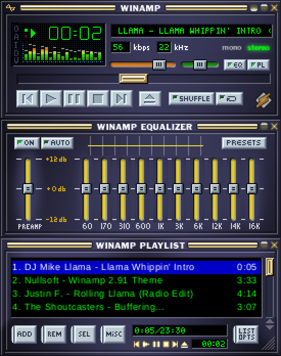

# NeoAmp

NeoAmp is a music player in Rust with a pixel-exact reproduction of the
classic Winamp 2.x interface (main window, equalizer and playlist editor),
drawn with classic Winamp skins, that plays MP3, WAV, FLAC and Ogg Vorbis
files. The transport buttons, position bar, volume, balance and ten-band
equalizer all act on the audio, and the visualizer shows what is actually
playing.

NeoAmp is an independent project, not affiliated with or endorsed by the
makers of Winamp. Winamp is a trademark of its owner.



## How it works

Classic Winamp skins (`.wsz` files) are zip archives of fixed-size sprite
sheets (`main.bmp`, `cbuttons.bmp`, `titlebar.bmp`, ...) plus a few text
files. Winamp itself just blitted rectangles out of those sheets, so this
program does the same:

- `src/canvas.rs` is a small RGBA software framebuffer with clipped blits.
- `src/sprites.rs` holds the sprite coordinates and window layout, which are
  identical for every classic skin.
- `src/skin.rs` reads a `.wsz` (zip + BMP/PNG), `viscolor.txt`,
  `pledit.txt` and `region.txt`, and falls back per sheet to the embedded
  base skin for anything a skin leaves out.
- `src/main_window.rs`, `src/eq_window.rs`, `src/playlist_window.rs` draw the
  three windows; `src/ui.rs` holds state, hit testing and input.
- `src/app.rs` runs one borderless `winit` window per NeoAmp window, presents
  each framebuffer through `pixels` (wgpu) and drives the title-bar drags and
  docking. `src/upscale.rs` draws the framebuffer over the whole window (see
  [Scaling](#scaling)), and `src/zoom.rs` picks the zoom.
- `src/open_dialog.rs` shows the platform's file dialog behind the eject
  button (see [Opening files](#opening-files)).
- `src/audio/` plays the music (see [Audio](#audio)), and `src/vis.rs` turns
  the samples being played into the spectrum analyzer and oscilloscope.
- `src/settings.rs` remembers the settings and the playlist between runs (see
  [Saved settings](#saved-settings)); `src/m3u.rs` reads and writes the
  playlist file.
- `src/lib.rs` exposes all of the above as a library; `src/main.rs` only
  parses the command line. `cargo test` covers layout, hit testing, input,
  the skin parsers, the blitter, the saved settings and playlist, and the
  audio pipeline (decoding, resampling, the equalizer, and the decoder and
  mixer threads working together).

Each NeoAmp window is its own borderless OS window. Grab a title bar to
drag one away; the main window carries whatever is docked to it, while the
equalizer and playlist leave on their own. Windows snap to each other's
edges and to the screen edges when they come within 10 pixels, like the
original. Resizing the playlist from its grip leaves the other windows where
they are, even ones docked to it, as Webamp does (how Winamp itself behaved
here is undocumented). `src/dock.rs` holds that geometry.

Docking needs to read and set window positions, which Wayland forbids, so
the app prefers the X11 backend (XWayland on a Wayland desktop) whenever
`DISPLAY` is set. Some compositors, COSMIC among them, also ignore moves of
managed X11 windows; the app notices this at startup and recreates its
windows as override-redirect windows, which are always placed exactly where
asked. Such windows have no taskbar entry, stay above other windows (like
Winamp's "always on top") and take keyboard focus when clicked.

- `NEOAMP_BACKEND=x11|wayland` forces a backend. On pure Wayland, title-bar
  drags are handed to the compositor and nothing snaps.
- `NEOAMP_UNMANAGED=1|0` forces or forbids override-redirect windows instead
  of probing.

## Audio

Playback follows Winamp's own input plugin, DSP, output plugin chain, spread
over three threads:

- A decoder thread reads the file with [symphonia](https://crates.io/crates/symphonia)
  (pure Rust: MP3, WAV, FLAC, Ogg Vorbis), converts it to stereo, resamples it
  to the sound card's rate with [rubato](https://crates.io/crates/rubato), and
  keeps about half a second queued in a lock-free ring buffer.
- The sound card's callback, through [cpal](https://crates.io/crates/cpal),
  takes audio from the ring and runs the equalizer, volume and balance. It
  also copies what it plays to the visualizer.
- The UI thread sends commands (open, seek, stop, pause) and reads back the
  position, bitrate and "track finished" events.

The callback never blocks or allocates, so the threads share only atomics and
ring buffers. Each command carries a generation number: before the decoder
queues audio for a seek or a new track, the callback drops whatever is still
queued from the old one and confirms, so stale audio never plays.

All three platforms behave the same:

- symphonia is pure Rust and needs no system libraries.
- cpal uses WASAPI on Windows, CoreAudio on macOS and ALSA on Linux, which
  reaches PipeWire and PulseAudio through their ALSA plugins.
- Resampling in the app means a 44.1 kHz file plays correctly on a 48 kHz
  device even where the system mixer would not convert it.

A background thread reads tags ("Artist - Title") and lengths for the
playlist as files are added.

## Scaling

Classic skins were drawn for one screen pixel per skin pixel on 800x600 and
1024x768 screens, which looks tiny on a modern monitor. The windows are zoomed
in half steps from 1x to 3x:

- **Default:** chosen from the height of the screen (in the desktop's logical
  pixels). 1080 lines stay at 1x, 1440 get 1.5x, 2160 get 2x. On a 27"
  1440p monitor, 1.5x is about the physical size Winamp had on a 15" CRT.
- **Ctrl+=** / **Ctrl+-** step the zoom, **Ctrl+0** goes back to the default,
  and `--scale 1|1.5|2|2.5|3` overrides it at startup. A zoom picked either
  way is remembered. At the default none is, so the next start picks one for
  whatever screen it finds.
- **Double size** (`D` in the clutter bar, Ctrl+D) doubles whatever the zoom
  is, as in Winamp, so 1.5x becomes 3x.
- The desktop's own scale factor applies on top, so a 200% desktop shows a 1x
  zoom at 2x.

Whole-number scales draw every skin pixel as an exact square of screen pixels.
Scales in between use a sharp-bilinear filter: each skin pixel keeps its flat
colour and only its edges blend over one screen pixel. Plain nearest-neighbour
at those scales would make some rows and columns a pixel wider than others,
which garbles the bitmap fonts. Windows are sized to whole screen pixels and the
image is stretched to fill them exactly, so docked windows meet without gaps.

## Opening files

Eject (in the main window, or the small one in the playlist's bottom bar) or
**L** opens the platform's own file dialog, through
[rfd](https://crates.io/crates/rfd). Pick one file or several: as with
Winamp's "Open file(s)", they replace the playlist and the first one plays.
Cancelling changes nothing. The windows keep drawing while the dialog is open.

The dialog starts on "All supported types" and also offers MP3, WAV, FLAC and
Ogg Vorbis one at a time. The platforms differ a little:

- **Windows:** the standard Open dialog, with the file types in its drop-down.
- **macOS:** an open panel that slides down from the main window as a sheet.
  macOS panels have no file type drop-down, so it always shows every
  supported type.
- **Linux:** the desktop's own file chooser, reached through the XDG desktop
  portal (GNOME, KDE, COSMIC and most other desktops run one). The portal is
  reached over D-Bus with the system's `libdbus`, which is loaded at runtime,
  so building needs no extra packages. Some choosers match file types
  case-sensitively, so both `*.mp3` and `*.MP3` are listed; a mixed-case name
  such as `song.Mp3` may be hidden there. Without a portal, rfd runs `zenity`
  instead if it is installed. With neither, eject does nothing and rfd logs
  why.

## Saved settings

NeoAmp starts the way it was left: volume, balance, the equalizer, shuffle,
repeat, the time display, the visualizer mode, which windows are open and
where, the playlist's size, the skin, the zoom and double size, and the
playlist with its current entry. The playlist comes back stopped, as in
Winamp. NeoAmp saves within a couple of seconds of a change and again on
exit, so a crash loses little.

Two files share one folder:

| Platform | Folder |
| --- | --- |
| Linux | `~/.config/neoamp/` (or `$XDG_CONFIG_HOME/neoamp/`) |
| Windows | `%APPDATA%\NeoAmp\` |
| macOS | `~/Library/Application Support/NeoAmp/` |

- `settings.toml` holds the settings. Edit it while NeoAmp is closed, since a
  running NeoAmp rewrites it (without comments). A missing key keeps its
  default, and an unusable value (a volume out of range, a zoom between the
  steps) is brought into range or falls back on its own. A file that cannot
  be read as settings is renamed `settings.toml.bad`, and NeoAmp starts with
  the defaults.
- `playlist.m3u8` is the playlist as an extended M3U file, which other players
  can open too. Entries whose length it records are not scanned again at
  startup.

[docs/SETTINGS.md](docs/SETTINGS.md) describes every setting: what it
controls, the values it takes and its default.

`NEOAMP_CONFIG_DIR=<folder>` keeps both files somewhere else. `--screenshot`
neither reads nor writes them. Files, a skin or `--scale` given on the command
line take precedence over what was saved and are remembered in turn, so files
replace the saved playlist.

The equalizer and playlist positions are kept relative to the main window, so
docked windows stay docked, and they are converted when the zoom or the
desktop's scale has changed since. Closing either window also remembers where
it was, and it reopens there, as in Winamp. A window whose title bar would land
off every screen (a monitor unplugged since, say) is placed the default way
instead. Each file is written beside the old one under a temporary name and
then renamed over it, so a crash during a save leaves the old file whole.

Where the platforms differ:

- **Pure Wayland:** window positions can be neither read nor set, so they are
  not saved. Whatever an X11 session saved stays for the next one.
- **Minimized windows** have no position worth keeping (Windows reports one far
  off the screen), so the last one from before is kept.
- **File names that are not valid Unicode**, which Linux allows, are written
  to the playlist as raw bytes and come back exactly. A skin at such a path is
  not remembered, because TOML holds only Unicode text. On Windows, the rare
  path that is not valid Unicode (an unpaired surrogate) is written with
  replacement characters, and that entry will not play after a restart.

## Building and running

The stock `base-2.91.wsz` skin must be present at `skins/base-2.91.wsz`; it is
embedded into the binary at build time.

On Linux, cpal needs the ALSA development files (Windows and macOS need
nothing extra):

```bash
sudo apt install libasound2-dev
```

```bash
cargo run --release
```

Play files or whole folders (folders add their MP3, WAV, FLAC and Ogg Vorbis
files, sorted by name); they replace the saved playlist and the first one
starts playing. Without any, the playlist from last time comes back. Dropping
files or folders onto any window adds them to the playlist too, and starts
them if nothing is playing. Eject picks files in a dialog (see
[Opening files](#opening-files)):

```bash
cargo run --release -- ~/Music/some-album
```

Load another classic skin by passing it on the command line or by dropping a
`.wsz` onto the window. It stays until another one replaces it; until there is
a skins menu, deleting the `skin` line from `settings.toml` (see
[Saved settings](#saved-settings)) goes back to the built-in skin:

```bash
cargo run --release -- ~/Downloads/Classic.wsz
```

Pick the zoom yourself instead of letting the screen size decide:

```bash
cargo run --release -- --scale 2
```

Render a frame to a PNG (always at 1x) without opening a window. It shows a
made-up playlist, with a synthetic signal in the visualizer:

```bash
cargo run --release -- --screenshot shot.png
```

## Controls

| Action | Mouse | Keyboard |
| --- | --- | --- |
| Previous / Play / Pause / Stop / Next | transport buttons | Z X C V B |
| Open files (they replace the playlist) | either eject button | L |
| Play a playlist entry | double-click it | |
| Shuffle / Repeat | toggle buttons | S / R |
| Elapsed vs. remaining time | click the time display | Ctrl+T |
| Equalizer / Playlist windows | EQ / PL buttons, window close buttons | Alt+G / Alt+E |
| Double size (doubles the zoom) | the `D` in the clutter bar | Ctrl+D |
| Zoom in / out / back to default | | Ctrl+= / Ctrl+- / Ctrl+0 |
| Volume, balance, EQ bands and preamp | drag the sliders (the marquee shows the value) | Up / Down: volume |
| Seek | drag the position bar; it seeks when you let go | Left / Right: 5 seconds |
| Equalizer on / off | the ON button | |
| Visualizer mode (analyzer, scope, off) | click the visualizer | |
| Move a window (docked ones follow the main window) | drag its title bar | |
| Resize the playlist | drag the grip in its bottom-right corner | |
| Playlist menus | hold ADD / REM / SEL / MISC / LIST OPTS | |

## Scope and limitations

- Classic 2.x skins (`.wsz`) only. Modern `.wal` skins are a different format.
- Windowshade mode, the options menus, cursors (`.cur`) and the minibrowser
  window are not implemented.
- The playlist can be replaced (eject) or added to (command line, drag and
  drop) but not edited, and shuffle does not change the order yet. Winamp's
  Shift+L (open a folder) and Ctrl+L (open a URL) are not implemented, nor
  are EQ presets and AUTO.
- Tracks play back to back with a short gap, not gaplessly.
- The output device is opened once, at startup, and never reopened. On Linux
  that device is PipeWire's or PulseAudio's, which move the stream to another
  output when one disappears. On Windows and macOS, losing the device (say,
  unplugging headphones) silences playback until the app restarts.
- The playlist uses a system TrueType font (Arial, Liberation Sans or
  DejaVu Sans, whichever exists) at the size Winamp used.
